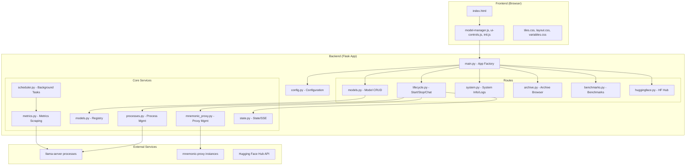
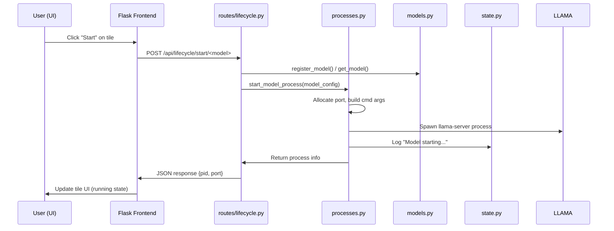
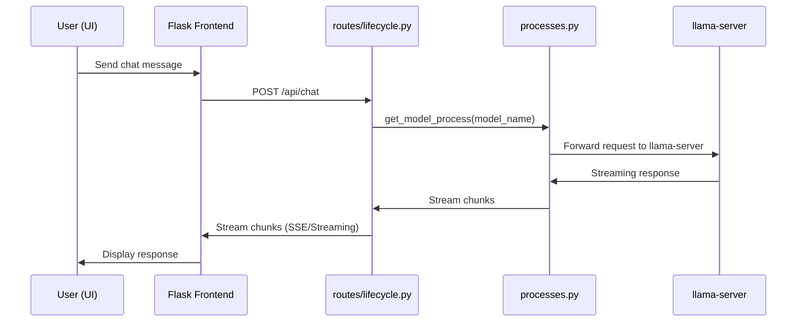
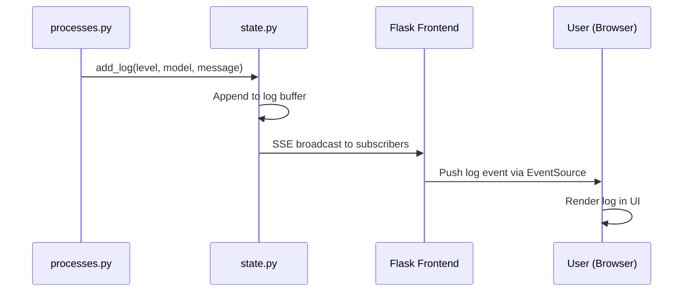

# System Architecture

## High-Level Architecture

## Request Flow: Model Startup

## Request Flow: Chat Completion

## Data Flow: Real-time State Logging

## Component Boundaries

| Component | Responsibility | Dependencies |
|-----------|---------------|--------------|
| `main.py` | App initialization, blueprint registration | Flask, config, routes |
| `config.py` | Configuration defaults & loading | os, dotenv |
| `models.py` (core) | Model registry, lookup, state | - |
| `processes.py` | llama-server process lifecycle | psutil, subprocess |
| `state.py` | Shared state, SSE logging | threading |
| `mnemonic_proxy.py` | Proxy instance management | requests, subprocess |
| `metrics.py` | Metrics scraping/parsing | requests, re |
| `scheduler.py` | Background task scheduling | threading/schedule |
