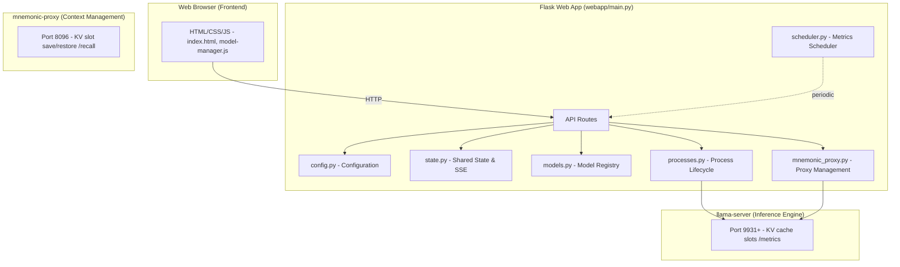
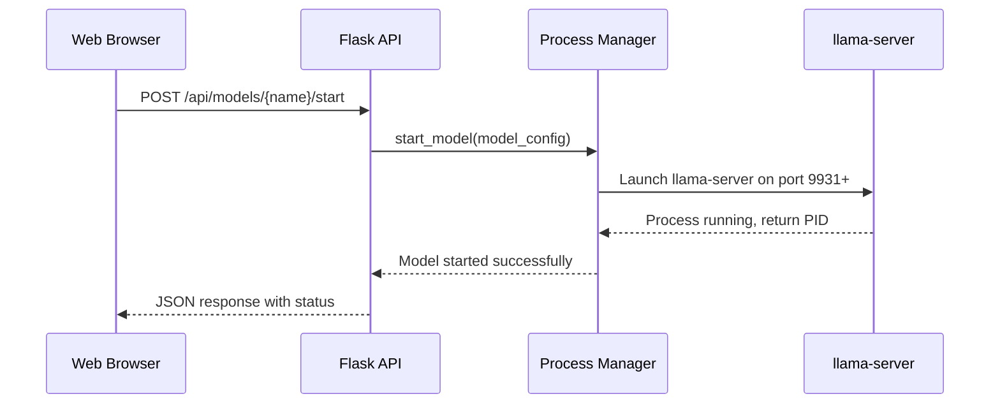
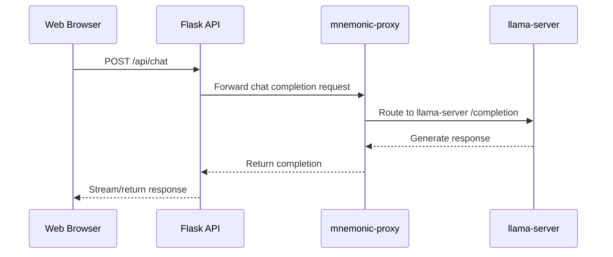

# Llama.cpp Model Manager - Codebase Analysis

## 1. Discovery

### Project Identity
- **Name**: llama.cpp Model Manager
- **Type**: Flask-based web application for managing llama.cpp model deployments
- **Entry Point**: `webapp/main.py`
- **Root Directory**: `/mnt/c/Users/russe/code/llama.cpp-model-manager/.kilo/worktrees/canary-crab/`

### Directory Structure
```
llama.cpp-model-manager/
├── webapp/                    # Main Flask application
│   ├── main.py               # Flask entry point (290 lines)
│   ├── config.py             # Configuration & defaults (1092 lines)
│   ├── models.py             # Model registry & management (206 lines)
│   ├── processes.py          # llama-server process lifecycle (156 lines)
│   ├── state.py              # Shared runtime state & SSE logging (99 lines)
│   ├── scheduler.py          # Background metrics export scheduler
│   ├── metrics.py            # Metrics scraping & parsing
│   ├── remote_client.py      # Remote API client abstraction
│   ├── utils.py              # Utility functions (68 lines)
│   ├── mnemonic_proxy.py     # Mnemonic proxy manager (1384 lines)
│   ├── mnemonic_proxy_updater.py
│   ├── llama_updater.py
│   ├── optimizer.py
│   ├── routes/               # API route blueprints
│   │   ├── models.py         # Model CRUD & registry (1200 lines)
│   │   ├── lifecycle.py      # Start/stop/model lifecycle (1116 lines)
│   │   ├── system.py         # System info, logs, health (156 lines)
│   │   ├── archive.py        # Archive browser & server (106 lines)
│   │   ├── benchmarks.py     # Benchmark management
│   │   ├── huggingface.py    # Hugging Face integration
│   │   └── ...               # Additional routes
│   ├── static/               # Frontend assets
│   │   ├── css/              # Stylesheets (variables, layout, tiles, etc.)
│   │   ├── js/               # JavaScript (model-manager, ui-controls, init, etc.)
│   │   └── vendor/           # Third-party libs (Chart.js)
│   └── templates/            # HTML templates
│       ├── index.html        # Main dashboard
│       └── state.js          # Client-side state management
├── tests/                    # Test suite (17 test files)
├── requirements.txt          # Python dependencies
└── README.md                 # Project documentation
```

### Core Dependencies (`requirements.txt`)
| Package | Purpose |
|---------|---------|
| `flask>=3.0.0` | Web framework |
| `requests>=2.31.0` | HTTP client for proxy/API calls |
| `urllib3>=2.0.0` | HTTP communication |
| `python-dotenv>=1.0.0` | Environment variable loading |
| `gpu-detector` | GPU hardware detection |
| `psutil>=5.9.0` | Process & system monitoring |
| `gguf>=0.10.0` | GGUF model file handling |

---

## 2. Architecture & Data Flow

### System Architecture



### Service Boundaries

| Module | Responsibility | Key Files |
|--------|---------------|-----------|
| **Web Server** | HTTP request handling, routing | `webapp/main.py` |
| **Model Management** | Model registry, CRUD operations | `webapp/models.py`, `webapp/routes/models.py` |
| **Process Lifecycle** | Start/stop/monitor llama-server processes | `webapp/processes.py`, `webapp/routes/lifecycle.py` |
| **Mnemonic Proxy** | Context management, KV cache persistence | `webapp/mnemonic_proxy.py` |
| **Metrics** | Scraping, parsing, exporting performance data | `webapp/metrics.py`, `webapp/scheduler.py` |
| **State Management** | Shared runtime state, SSE logging | `webapp/state.py` |
| **Configuration** | Defaults, environment variables, paths | `webapp/config.py` |

### Data Flow: Model Startup



### Data Flow: Chat Request



---

## 3. Feature & Implementation Breakdown

### Key Features

| Feature | Description | Implementation Location |
|---------|-------------|------------------------|
| **Model CRUD** | Add, list, start, stop, delete models | `routes/models.py`, `models.py` |
| **Chat Proxy** | OpenAI-compatible `/api/chat` endpoint | `routes/lifecycle.py` (proxy logic) |
| **Mnemonic Proxy** | Long-context management via KV cache slots | `mnemonic_proxy.py` |
| **Slot Persistence** | Save/restore KV cache per model session | `mnemonic_proxy.py`, `routes/archive.py` |
| **Metrics Collection** | Scrape `/metrics` from running models | `metrics.py`, `scheduler.py` |
| **Hugging Face Integration** | Search/discover models from HF Hub | `routes/huggingface.py` |
| **Model Downloads** | Background GGUF file downloads | `llama_updater.py` |
| **System Info** | Hardware detection (CPU/GPU/Memory) | `routes/system.py` |
| **Remote Mode** | Connect to remote llama-server instance | `remote_client.py` |
| **WSL Support** | Windows Subsystem for Linux wrapper | `config.py` (path handling) |

### Frontend Architecture

The frontend is a single-page application built with:
- **HTML**: `templates/index.html` - Main dashboard with tile-based model grid
- **CSS**: `static/css/` - Variables, layout, component styles (tiles, buttons, panels)
- **JavaScript**: `static/js/` - 
  - `model-manager.js` - Core UI logic, tile rendering, model operations
  - `ui-controls.js` - UI control handlers (hide model, properties panel)
  - `init.js` - Initialization and event binding
  - `state.js` - Client-side state management

### Backend API Surface

The Flask app exposes RESTful endpoints organized by route blueprint:

| Blueprint | Base Path | Key Endpoints |
|-----------|-----------|---------------|
| **models** | `/api/models` | `GET /`, `POST /`, `GET /{name}`, `DELETE /{name}` |
| **lifecycle** | `/api/lifecycle` | `POST /{name}/start`, `POST /{name}/stop`, `GET /{name}/status` |
| **system** | `/api/system` | `GET /info`, `GET /logs`, `POST /shutdown` |
| **archive** | `/api/archive` | `GET /journal/{model}`, `GET /browser/{model}` |
| **benchmarks** | `/api/benchmarks` | `GET /`, `POST /run` |
| **huggingface** | `/api/hf` | `GET /repo-search`, `GET /models` |

---

## 4. Setup, Operations & Gaps

### Local Setup

1. **Install dependencies**: `pip install -r requirements.txt`
2. **Environment variables**: Configured via `config.py` and `.env` file (if present)
3. **Run application**: `python webapp/main.py` (starts Flask on port 5000)

### Key Environment Variables
- `REMOTE_MODE` - Enable remote mode (disables local lifecycle operations)
- `MNEMONIC_PROXY_START_TIMEOUT` - Proxy startup timeout (default: 30s)
- `MNEMONIC_PROXY_HEALTH_TIMEOUT` - Health check timeout (default: 2s)

### Testing

**Test suite**: 17 test files in `tests/` directory covering:
- API endpoints (`test_api.py`, `test_routes.py`)
- Archive functionality (`test_archive_*.py`)
- Metrics (`test_metrics.py`, `test_exporter.py`)
- Mnemonic proxy (`test_mnemonic_proxy.py`)
- Processes (`test_processes.py`)
- Configuration (`test_config.py`)
- Hugging Face integration (`test_huggingface_routes.py`)
- Integration tests (`test_integration.py`)

**Run tests**: `pytest tests/` (or `python -m pytest`)

### Technical Debt & Observations

1. **Large configuration file**: `config.py` is 1092 lines - consider splitting into modular config sections.
2. **Large route files**: `routes/models.py` (1200 lines) and `routes/lifecycle.py` (1116 lines) - could benefit from further subdivision.
3. **Mnemonic proxy complexity**: `mnemonic_proxy.py` is 1384 lines with deep process management logic - high cognitive load.
4. **Empty `__init__.py`**: `webapp/__init__.py` is empty - may indicate missed opportunity for package-level initialization.
5. **Inferred**: The project uses SSE (Server-Sent Events) for real-time log streaming, as indicated in `state.py` and the README.
6. **Inferred**: The frontend uses a tile-based UI where each model is represented as a "tile" with status indicators, action buttons, and properties panel.

### Missing/Unverified Items

- **No explicit build system**: No Makefile, pyproject.toml, or setup.py beyond requirements.txt.
- **No Docker configuration**: Not present in the explored files.
- **Unverified**: Exact test runner command (pytest vs unittest) - inferred from file naming convention.
- **Unverified**: Whether there's a production WSGI entry point (gunicorn/uwsgi config) - only Flask dev server appears documented.
