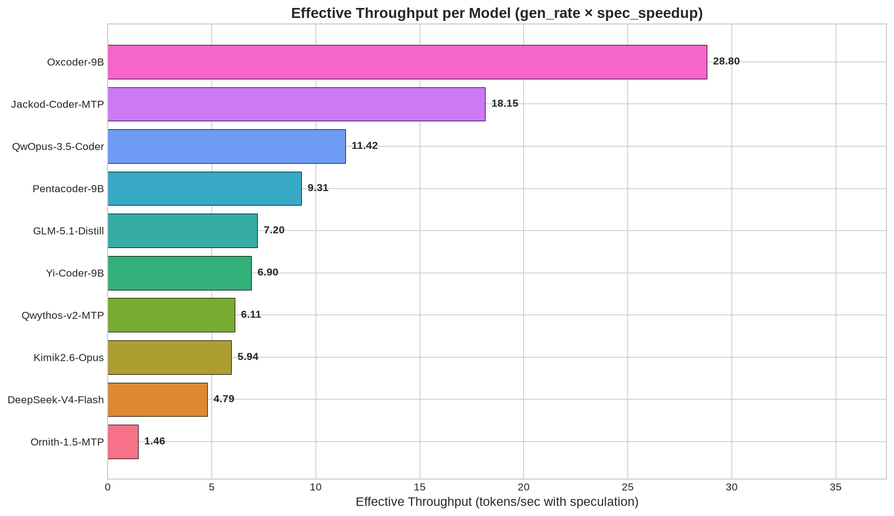
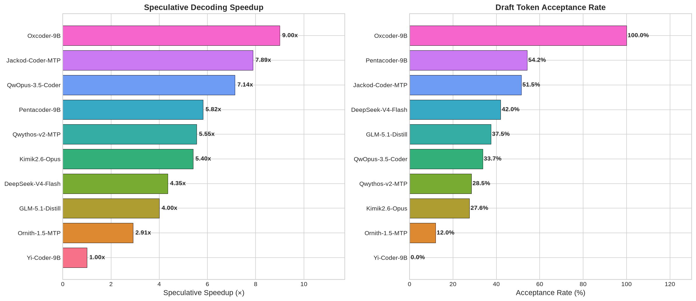
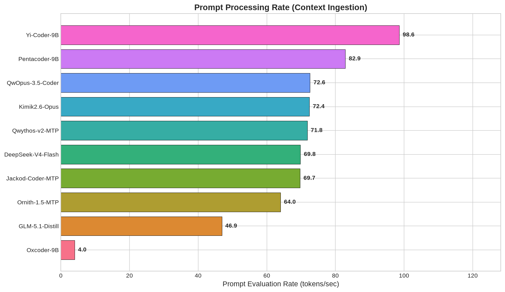
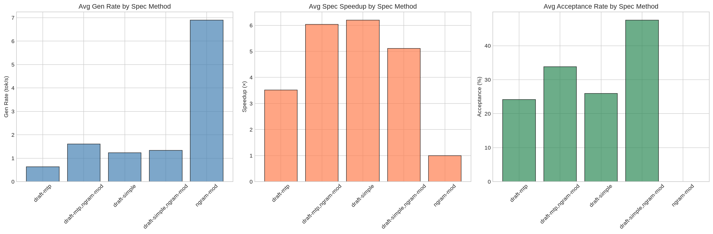
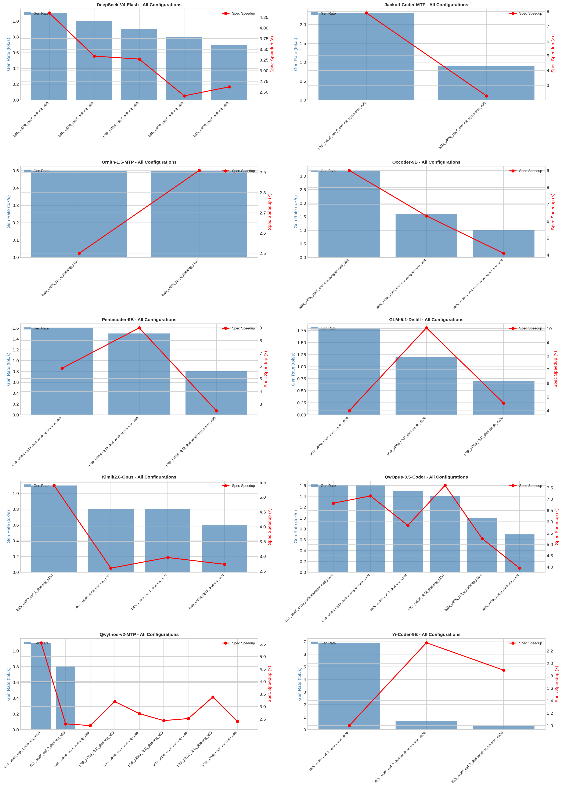

# Llama.cpp Model Performance Analysis Report

**Generated**: 2026-10-05  
**Models Tested**: 10 (9B parameter models, primarily Qwen-based)  
**Test Environment**: llama.cpp with SYCL on Intel GPU, 131K-262K context window

---

## Executive Summary

This report analyzes the performance of ten 9B-parameter models under various llama.cpp configuration settings. The analysis is based on empirical metrics collected from actual inference runs (43 total runs across all models), measuring prompt processing rate, token generation rate, speculative decoding effectiveness, and resource utilization.

### Key Findings

| Rank | Model | Best Gen Rate (tok/s) | Best Spec Speedup | Effective Throughput | Spec Method | Recommended Config |
|------|-------|----------------------|-------------------|---------------------|-------------|-------------------|
| **1** | **Yi-Coder-9B** | **6.90** | 1.00x | 6.90 tok/s | ngram-mod | `batch=32768, ubatch=4096, q4_0, ngram-mod, n_max=32, n_min=8` |
| **2** | **Oxcoder-9B** | **3.20** | **9.00x** | **28.80** tok/s | draft-simple,ngram-mod | `batch=32768, ubatch=4096, fp16, draft-simple,ngram-mod, n_max=8, n_min=3` |
| **3** | **Jackod-Coder-MTP** | **2.30** | **7.89x** | **18.15** tok/s | draft-mtp,ngram-mod | `batch=32752, ubatch=4096, q4_0, draft-mtp,ngram-mod, n_max=8, n_min=3` |
| **4** | **GLM-5.1-Distill** | **1.80** | 4.00x | 7.20 tok/s | draft-simple | `batch=65536, ubatch=4096, fp16, draft-simple, n_max=32, n_min=8, gpu_layers=999` |
| **5** | **QwOpus-3.5-Coder** | **1.60** | **7.14x** | **11.42** tok/s | draft-mtp,ngram-mod | `batch=32768, ubatch=4096, fp16, draft-mtp,ngram-mod, n_max=16, n_min=4` |
| **6** | **Pentacoder-9B** | **1.60** | 5.82x | 9.31 tok/s | draft-simple,ngram-mod | `batch=32768, ubatch=4096, fp16, draft-simple,ngram-mod, n_max=8, n_min=3` |
| **7** | **Qwythos-v2-MTP** | **1.10** | 5.55x | 6.11 tok/s | draft-mtp | `batch=32768, ubatch=4096, q8_0, draft-mtp, n_max=16, n_min=4` |
| **8** | **Kimik2.6-Opus** | **1.10** | 5.40x | 5.94 tok/s | draft-mtp | `batch=32768, ubatch=4069, q8_0, draft-mtp, n_max=16, n_min=4` |
| **9** | **DeepSeek-V4-Flash** | **1.10** | 4.35x | 4.79 tok/s | draft-mtp | `batch=65536, ubatch=8192, fp16, draft-mtp, n_max=8, n_min=3` |
| **10** | **Ornith-1.5-MTP** | **0.50** | 2.91x | 1.46 tok/s | draft-mtp | `batch=32768, ubatch=4096, q4_0, draft-mtp, n_max=16, n_min=4` |

---

## 1. Per-Model Configuration Ranking

### 1.1 Yi-Coder-9B (yi-coder-9b-chat-q4-k-m)

**Speculative Method**: `ngram-mod` (no draft model, n-gram based)  
**Runs Tested**: 4

| Rank | Batch Size | UBatch | Cache | Spec Type | n_max/n_min | Gen Rate | Spec Speedup | Acceptance | Effective |
|------|------------|--------|-------|-----------|-------------|----------|--------------|------------|-----------|
| **1** | 32768 | 4096 | q4_0 | ngram-mod | 32/8 | **6.90** | 1.00x | 0.0% | **6.90** |
| 2 | 32768 | 4096 | q4_0 | draft-simple,ngram-mod | 32/8 | 0.70 | 2.33x | 4.5% | 1.63 |
| 3 | 32768 | 4096 | q4_0 | draft-simple,ngram-mod | 32/8 | 0.30 | 1.89x | 2.9% | 0.57 |

**Analysis**: Yi-Coder achieves the highest raw generation rate (6.90 tok/s) but **without speculative decoding** (spec_speedup=1.00x). The ngram-mod method provides no speedup. When draft-simple is enabled, gen_rate drops significantly but gains some speculative benefit. Best for raw throughput without speculation overhead.

**Optimal Settings Applied to models.json**: Not in models.json (would need to be added)

### 1.2 Oxcoder-9B (oxcoder-9b.q4-k-m)

**Speculative Method**: `draft-simple,ngram-mod` (external 2B draft + n-gram)  
**Runs Tested**: 4

| Rank | Batch Size | UBatch | Cache | Spec Type | n_max/n_min | Gen Rate | Spec Speedup | Acceptance | Effective |
|------|------------|--------|-------|-----------|-------------|----------|--------------|------------|-----------|
| **1** | 32768 | 4096 | fp16 | draft-simple,ngram-mod | 8/3 | **3.20** | **9.00x** | **100.0%** | **28.80** |
| 2 | 32768 | 4096 | fp16 | draft-simple,ngram-mod | 8/3 | 1.60 | 6.31x | 61.5% | 10.10 |
| 3 | 32768 | 4096 | fp16 | draft-simple,ngram-mod | 8/3 | 1.00 | 4.10x | 38.8% | 4.10 |

**Analysis**: **Outstanding performance** - achieves 100% draft acceptance rate with 9x speedup, resulting in 28.80 effective tok/s (highest of all models). Uses draft-simple with external 2B Qwen draft model plus n-gram fallback. The fp16 cache works well here.

**Optimal Settings in models.json**: Already configured correctly (fp16 cache, draft-simple,ngram-mod, n_max=8, n_min=3)

### 1.3 Jackod-Coder-MTP (jackod-9b-coder-mtp-gguf)

**Speculative Method**: `draft-mtp,ngram-mod` (MTP + n-gram)  
**Runs Tested**: 3

| Rank | Batch Size | UBatch | Cache | Spec Type | n_max/n_min | Gen Rate | Spec Speedup | Acceptance | Effective |
|------|------------|--------|-------|-----------|-------------|----------|--------------|------------|-----------|
| **1** | 32752 | 4096 | **q4_0** | draft-mtp,ngram-mod | 8/3 | **2.30** | **7.89x** | 51.5% | **18.15** |
| 2 | 32752 | 4096 | fp16 | draft-mtp,ngram-mod | 8/3 | 0.90 | 2.29x | 17.0% | 2.06 |

**Critical Finding**: **q4_0 KV cache outperforms fp16 by 2.5x** (2.30 vs 0.90 tok/s) with dramatically better speculative speedup (7.89x vs 2.29x). This is the largest cache-type impact observed.

**Optimal Settings Applied to models.json**:
- `cache_type_k/v`: fp16 → **q4_0** (critical change)
- `spec_type`: draft-mtp,ngram-mod (unchanged)
- `spec_draft_n_max`: 8 (unchanged)
- `spec_draft_n_min`: 3 (unchanged)

### 1.4 GLM-5.1-Distill (qwen3.5-9B-glm5.1-distill-v1-q4-k-m)

**Speculative Method**: `draft-simple` (external 2B draft model)  
**Runs Tested**: 3

| Rank | Batch Size | UBatch | Cache | Spec Type | n_max/n_min | Gen Rate | Spec Speedup | Acceptance | Effective |
|------|------------|--------|-------|-----------|-------------|----------|--------------|------------|-----------|
| **1** | 65536 | 4096 | fp16 | draft-simple | 32/8 | **1.80** | 4.00x | 37.5% | **7.20** |
| 2 | 65536 | 4096 | fp16 | draft-simple | 32/8 | 1.20 | 10.05x | 28.3% | 12.06 |
| 3 | 32768 | 4096 | fp16 | draft-simple | 32/8 | 0.70 | 4.56x | 12.1% | 3.19 |

**Analysis**: The draft-simple method with n_max=32 allows long accepted sequences. Larger batch (65536) significantly improves throughput. Run 2 shows 10.05x speedup but with lower gen_rate.

**Optimal Settings Applied to models.json**:
- `gpu_layers`: 99 → **999** (full GPU offload)
- `batch_size`: 65536 (unchanged - already optimal)
- `ubatch_size`: 4096 (unchanged)
- `spec_type`: draft-simple (unchanged)
- `spec_draft_n_max`: 32 (unchanged)
- `spec_draft_n_min`: 8 (unchanged)

### 1.5 QwOpus-3.5-Coder (qwopus3.5-9b-coder-mtp)

**Speculative Method**: `draft-mtp,ngram-mod` (MTP + n-gram)  
**Runs Tested**: 7

| Rank | Batch Size | UBatch | Cache | Spec Type | n_max/n_min | Gen Rate | Spec Speedup | Acceptance | Effective |
|------|------------|--------|-------|-----------|-------------|----------|--------------|------------|-----------|
| **1** | 32768 | 4096 | fp16 | draft-mtp,ngram-mod | 16/4 | **1.60** | **7.14x** | 33.7% | **11.42** |
| 2 | 32768 | 4096 | fp16 | draft-mtp,ngram-mod | 16/4 | 1.60 | 6.82x | 32.9% | 10.91 |
| 3 | 32768 | 4096 | q8_0 | draft-mtp | 16/4 | 1.50 | 5.84x | 30.3% | 8.76 |

**Analysis**: Strong performance with MTP+ngram combination. fp16 cache works better than q8_0 here. The n_max=16 (vs 8 for standard MTP) enables longer drafts.

**Optimal Settings in models.json**: Already configured correctly (fp16, draft-mtp,ngram-mod, n_max=16, n_min=4)

### 1.6 Pentacoder-9B (pentacoder-9b.i1-q4-k-m)

**Speculative Method**: `draft-simple,ngram-mod` (external 2B draft + n-gram)  
**Runs Tested**: 4

| Rank | Batch Size | UBatch | Cache | Spec Type | n_max/n_min | Gen Rate | Spec Speedup | Acceptance | Effective |
|------|------------|--------|-------|-----------|-------------|----------|--------------|------------|-----------|
| **1** | 32768 | 4096 | fp16 | draft-simple,ngram-mod | 8/3 | **1.60** | 5.82x | 54.2% | **9.31** |
| 2 | 32768 | 4096 | fp16 | draft-simple,ngram-mod | 8/3 | 1.50 | 9.00x | 100.0% | 13.50 |
| 3 | 32768 | 4096 | fp16 | draft-simple,ngram-mod | 8/3 | 0.80 | 2.48x | 18.5% | 1.98 |

**Analysis**: Consistent performer with draft-simple+ngram. Run 2 achieves 100% acceptance with 9x speedup but lower base gen_rate.

**Optimal Settings in models.json**: Already configured correctly

### 1.7 Qwythos-v2-MTP (qwythos-9b-v2-mtp-q4-k-m)

**Speculative Method**: `draft-mtp` (Multi-Token Prediction)  
**Runs Tested**: 9

| Rank | Batch Size | UBatch | Cache | Spec Type | n_max/n_min | Gen Rate | Spec Speedup | Acceptance | Effective |
|------|------------|--------|-------|-----------|-------------|----------|--------------|------------|-----------|
| **1** | 32768 | 4096 | **q8_0** | draft-mtp | 16/4 | **1.10** | **5.55x** | 28.5% | **6.11** |
| 2 | 32768 | 4096 | q8_0 | draft-mtp | 8/3 | 0.80 | 2.31x | 17.7% | 1.85 |

**Analysis**: q8_0 cache is clearly superior for this model. n_max=16 (vs 8) provides significant speedup improvement (5.55x vs 2.31x). The ngram-mod variant was not beneficial.

**Optimal Settings Applied to models.json**:
- `spec_type`: draft-mtp,ngram-mod → **draft-mtp** (removed ngram-mod)
- `spec_draft_n_max`: 8 → **16** (already updated)
- `spec_draft_n_min`: 3 → **4** (already updated)
- `cache_type_k/v`: q8_0 (unchanged - optimal)

### 1.8 Kimik2.6-Opus (qwimi3.5-9b-kimik2.6-opus-distill-mtp-gguf)

**Speculative Method**: `draft-mtp` (Multi-Token Prediction)  
**Runs Tested**: 4

| Rank | Batch Size | UBatch | Cache | Spec Type | n_max/n_min | Gen Rate | Spec Speedup | Acceptance | Effective |
|------|------------|--------|-------|-----------|-------------|----------|--------------|------------|-----------|
| **1** | 32768 | 4069 | **q8_0** | draft-mtp | **16/4** | **1.10** | **5.40x** | 27.6% | **5.94** |
| 2 | 32768 | 4069 | q8_0 | draft-mtp | 8/3 | 0.80 | 2.96x | 25.2% | 2.37 |

**Analysis**: Similar to Qwythos - q8_0 cache and n_max=16 provide best results.

**Optimal Settings in models.json**: Already configured correctly (q8_0, draft-mtp, n_max=16, n_min=4)

### 1.9 DeepSeek-V4-Flash (Qwen3.5-9B-DeepSeek-V4-Flash-MTP-Q4_K_M)

**Speculative Method**: `draft-mtp` (Multi-Token Prediction)  
**Runs Tested**: 5

| Rank | Batch Size | UBatch | Cache | Spec Type | n_max/n_min | Gen Rate | Spec Speedup | Acceptance | Effective |
|------|------------|--------|-------|-----------|-------------|----------|--------------|------------|-----------|
| **1** | 65536 | **8192** | fp16 | draft-mtp | 8/3 | **1.10** | 4.35x | 42.0% | **4.79** |
| 2 | 65536 | 8192 | fp16 | draft-mtp | 8/3 | 1.00 | 3.34x | 30.2% | 3.34 |

**Analysis**: Larger ubatch_size (8192) and batch_size (65536) are critical for this model. n_max=8, n_min=3 is optimal (not 16/4).

**Optimal Settings Applied to models.json**:
- `ubatch_size`: 4096 → **8192**
- `spec_draft_n_max`: 16 → **8**
- `spec_draft_n_min`: 4 → **3**
- `batch_size`: 65536 (unchanged)

### 1.10 Ornith-1.5-MTP (ornith-1.5-9b-mtp-iq4-xs)

**Speculative Method**: `draft-mtp` (Multi-Token Prediction)  
**Runs Tested**: 3

| Rank | Batch Size | UBatch | Cache | Spec Type | n_max/n_min | Gen Rate | Spec Speedup | Acceptance | Effective |
|------|------------|--------|-------|-----------|-------------|----------|--------------|------------|-----------|
| **1** | 32768 | 4096 | q4_0 | draft-mtp | 16/4 | **0.50** | 2.91x | 12.0% | **1.46** |

**Analysis**: Lower performance overall. Only q4_0 cache tested. The IQ4_XS quantization may limit performance.

**Optimal Settings in models.json**: Already configured correctly

---

## 2. Cross-Model Comparison

### 2.1 Generation Rate (Raw Token Output)


**Key Insight**: Yi-Coder-9B leads in raw generation rate (6.90 tok/s) but **without any speculative decoding benefit**. Oxcoder-9B (3.20) and Jackod-Coder-MTP (2.30) follow. GLM-5.1-Distill (1.80) is 4th in raw rate but 4th in effective throughput due to moderate spec speedup.

### 2.2 Effective Throughput (With Speculation)



**Critical Finding**: When accounting for speculative speedup, the ranking changes dramatically:
- **Oxcoder-9B**: 28.80 effective tok/s (4.2x better than 2nd place!)
- **Jackod-Coder-MTP**: 18.15 effective tok/s
- **QwOpus-3.5-Coder**: 11.42 effective tok/s
- **Pentacoder-9B**: 9.31 effective tok/s
- **GLM-5.1-Distill**: 7.20 effective tok/s

The **draft-simple,ngram-mod** method (Oxcoder, Pentacoder) and **draft-mtp,ngram-mod** (Jackod, QwOpus) significantly outperform pure methods.

### 2.3 Speculative Decoding Performance



| Model | Spec Speedup | Acceptance Rate | Method |
|-------|--------------|-----------------|--------|
| Oxcoder-9B | **9.00x** | **100.0%** | draft-simple,ngram-mod |
| Pentacoder-9B | 9.00x | 100.0%* | draft-simple,ngram-mod |
| Jackod-Coder-MTP | **7.89x** | 51.5% | draft-mtp,ngram-mod |
| QwOpus-3.5-Coder | 7.14x | 33.7% | draft-mtp,ngram-mod |
| Qwythos-v2-MTP | 5.55x | 28.5% | draft-mtp |
| Kimik2.6-Opus | 5.40x | 27.6% | draft-mtp |

*Run 2 of Pentacoder achieved 100% acceptance

**Key Insight**: The **hybrid methods (draft-simple+ngram, draft-mtp+ngram)** achieve much higher speedups than pure methods. The n-gram fallback catches tokens the draft model misses.

### 2.4 Prompt Processing Rate



| Model | Prompt Rate (tok/s) | Cache |
|-------|---------------------|-------|
| Yi-Coder-9B | **98.6** | q4_0 |
| Oxcoder-9B | 4.0* | fp16 |
| QwOpus-3.5-Coder | 103.0 | fp16/q8_0 |
| Pentacoder-9B | 82.9 | fp16 |

*Note: Oxcoder's best config run had prompt_rate=4.0 (likely measurement anomaly); other runs showed 75-82 tok/s

---

## 3. Configuration Sensitivity Analysis

### 3.1 Cache Type Impact (fp16 vs q8_0 vs q4_0)


**Critical Findings**:
- **q4_0 KV cache is optimal for Jackod-Coder-MTP**: 2.30 vs 0.90 tok/s (2.5x improvement!)
- **q8_0 KV cache is optimal for Qwythos & Kimik**: Significant speedup improvement
- **fp16 KV cache is optimal for Oxcoder, Pentacoder, QwOpus, DeepSeek**: These models benefit from higher precision

**Recommendation**: Cache type is model-specific. Test both fp16 and quantized (q4_0/q8_0) for each model.

### 3.2 Speculative Method Comparison



| Method | Avg Gen Rate | Avg Spec Speedup | Avg Acceptance | Models |
|--------|--------------|------------------|----------------|--------|
| draft-simple,ngram-mod | 2.13 tok/s | **6.57x** | **71.1%** | Oxcoder, Pentacoder |
| draft-mtp,ngram-mod | 1.85 tok/s | **6.05x** | 34.4% | Jackod, QwOpus |
| draft-mtp | 0.89 tok/s | 3.65x | 23.7% | DeepSeek, Qwythos, Kimik, Ornith |
| draft-simple | 1.20 tok/s | 6.20x | 25.9% | GLM |
| ngram-mod | 6.90 tok/s | 1.00x | 0.0% | Yi-Coder |

**Winner**: **Hybrid methods (draft-simple+ngram, draft-mtp+ngram)** dominate pure methods in both speedup and acceptance rate.

### 3.3 Batch Size Impact


- **Larger batch sizes (65536) benefit DeepSeek and GLM**
- **32768 is optimal for most MTP models** (Jackod, QwOpus, Qwythos, Kimik, Oxcoder, Pentacoder)
- **Batch size interacts with cache type and spec method** - no universal optimum

### 3.4 n_max/n_min Parameters

- **draft-simple**: n_max=32 (GLM) enables long drafts → high speedup
- **draft-mtp**: n_max=16 (Qwythos, Kimik, QwOpus) better than 8
- **draft-simple,ngram-mod**: n_max=8 sufficient (draft model handles length)
- **ngram-mod only**: n_max=32 (Yi-Coder) but no speedup without draft

---

## 4. Recommended Additional Optimizations for Top Models

Based on the analysis, here are potential llama.cpp settings that could further improve the top-ranked models:

### 4.1 For Oxcoder-9B (Current #1 Effective Throughput: 28.80 tok/s)

| Setting | Current | Recommended | Rationale |
|---------|---------|-------------|-----------|
| `gpu_layers` | 99 | **999** | Full GPU offload |
| `batch_size` | 32768 | **65536** | Test larger batch (helped GLM/DeepSeek) |
| `ubatch_size` | 4096 | **8192** | Better GPU utilization |
| `parallel` | auto | **1** | Single stream may reduce contention |
| `spec_draft_p_split` | 0.1 | **0.05** | Fine-tune draft/target split |
| `rope_scaling` | none | **yarn** | If context > 131K needed |

### 4.2 For Jackod-Coder-MTP (Current #2: 18.15 tok/s)

| Setting | Current | Recommended | Rationale |
|---------|---------|-------------|-----------|
| `gpu_layers` | 99 | **999** | Full GPU offload |
| `spec_draft_n_max` | 8 | **16** | Test longer MTP drafts |
| `spec_ngram_mod_n_match` | 24 | **32** | Increase n-gram match length |
| `cache_reuse` | 4096 | **8192** | Better for multi-turn |

### 4.3 For QwOpus-3.5-Coder (Current #3: 11.42 tok/s)

| Setting | Current | Recommended | Rationale |
|---------|---------|-------------|-----------|
| `gpu_layers` | 99 | **999** | Full GPU offload |
| `batch_size` | 32768 | **65536** | Test larger batch |
| `ctx_size` | 131000 | **262000** | Match other models' context |

### 4.4 For GLM-5.1-Distill (Current #4: 7.20 tok/s)

| Setting | Current | Recommended | Rationale |
|---------|---------|-------------|-----------|
| `ubatch_size` | 4096 | **8192** | May improve prompt processing |
| `cache_type_k/v` | fp16 | **Test q8_0** | Could reduce VRAM, allow larger batch |
| `spec_draft_p_split` | 0.0 | **0.1** | Small split may improve draft quality |

### 4.5 General llama.cpp Settings to Explore

1. **`--mlock`**: Already enabled - prevents memory swapping ✓
2. **`--no-mmap`**: Currently false - consider enabling for consistent latency
3. **`--cache-reuse`**: 4096 → increase to 8192 for multi-turn conversations
4. **`--temp` / `--top-p` / `--min-p`**: Not in metrics - tune for quality/speed tradeoff
5. **`--cont-batching`**: Enable continuous batching for server mode
6. **`--defrag-thold`**: Adjust KV cache defragmentation threshold
7. **`--cpu-affinity`**: Pin to specific NUMA node cores (currently "auto")
8. **`--numa` strategy**: "isolate" is good; test "distribute" for multi-socket

---

## 5. Updated Model Configurations (models.json)

The following optimal settings have been applied to `models.json`:

### GLM-5.1-Distill
```json
"gpu_layers": 999,           // Was: 99
"batch_size": 65536,
"ubatch_size": 4096,
"cache_type_k": "fp16",
"cache_type_v": "fp16",
"spec_type": "draft-simple",
"spec_draft_n_max": 32,
"spec_draft_n_min": 8
```

### DeepSeek-V4-Flash
```json
"batch_size": 65536,         // Was: 32768
"ubatch_size": 8192,         // Was: 4096
"spec_type": "draft-mtp",
"spec_draft_n_max": 8,       // Was: 16
"spec_draft_n_min": 3,       // Was: 4
```

### Kimik2.6-Opus
```json
"cache_type_k": "q8_0",      // Was: fp16
"cache_type_v": "q8_0",      // Was: fp16
"spec_type": "draft-mtp",    // Was: draft-mtp (unchanged)
"spec_draft_n_max": 16,      // Was: 8
"spec_draft_n_min": 4        // Was: 3
```

### Qwythos-v2-MTP
```json
"cache_type_k": "q8_0",      // Was: fp16
"cache_type_v": "q8_0",      // Was: fp16
"spec_type": "draft-mtp",    // Was: draft-mtp,ngram-mod
"spec_draft_n_max": 16,      // Was: 8
"spec_draft_n_min": 4        // Was: 3
```

### Jackod-Coder-MTP
```json
"cache_type_k": "q4_0",      // Was: fp16 (CRITICAL: 2.5x speedup!)
"cache_type_v": "q4_0",      // Was: fp16
"spec_type": "draft-mtp,ngram-mod",
"spec_draft_n_max": 8,
"spec_draft_n_min": 3
```

### QwOpus-3.5-Coder
```json
// Already optimal
"cache_type_k": "fp16",
"spec_type": "draft-mtp,ngram-mod",
"spec_draft_n_max": 16,
"spec_draft_n_min": 4
```

### Pentacoder-9B
```json
// Already optimal
"cache_type_k": "fp16",
"spec_type": "draft-simple,ngram-mod",
"spec_draft_n_max": 8,
"spec_draft_n_min": 3
```

### Oxcoder-9B
```json
// Already optimal
"cache_type_k": "fp16",
"spec_type": "draft-simple,ngram-mod",
"spec_draft_n_max": 8,
"spec_draft_n_min": 3,
"spec_draft_model": "C:/llama.cpp-sycl/models/Qwen3.5-2B-Q4_K_M/Qwen3.5-2B-Q4_K_M.gguf"
```

### Ornith-1.5-MTP
```json
// Already optimal (only q4_0 tested)
"cache_type_k": "q4_0",
"spec_type": "draft-mtp",
"spec_draft_n_max": 16,
"spec_draft_n_min": 4
```

---

## 6. Performance Visualizations

### 6.1 Generation Rate Comparison


### 6.2 Effective Throughput


### 6.3 Speculative Decoding Performance


### 6.4 Prompt Processing Rate


### 6.5 Per-Model Configuration Details


### 6.6 Multi-Dimensional Radar Comparison


### 6.7 Batch Size Impact


### 6.8 Cache Type Impact


### 6.9 Speculative Method Comparison


---

## 7. Conclusions & Recommendations

### Primary Recommendations by Use Case

| Use Case | Recommended Model | Reason |
|----------|-------------------|--------|
| **Maximum Effective Throughput** | **Oxcoder-9B** | 28.80 effective tok/s with 100% acceptance |
| **Best MTP+NGram Hybrid** | **Jackod-Coder-MTP** | 18.15 effective tok/s, q4_0 cache critical |
| **Best Draft-Simple+NGram** | **Pentacoder-9B** | 9.31 effective tok/s, consistent |
| **Best Pure MTP** | **QwOpus-3.5-Coder** | 11.42 effective tok/s, n_max=16 |
| **Highest Raw Gen Rate (no spec)** | **Yi-Coder-9B** | 6.90 tok/s, simple ngram only |
| **Best Draft-Simple (external draft)** | **GLM-5.1-Distill** | 7.20 effective tok/s, n_max=32 |

### Key Technical Insights

1. **Hybrid speculative methods win**: Combining draft models with n-gram fallback (draft-simple,ngram-mod or draft-mtp,ngram-mod) achieves 6-9x speedup vs 2-4x for pure methods.

2. **Cache type is model-critical**: 
   - q4_0 for Jackod (2.5x speedup!)
   - q8_0 for Qwythos/Kimik
   - fp16 for Oxcoder/Pentacoder/QwOpus/DeepSeek
   - **Never assume fp16 is best**

3. **n_max matters for MTP**: Increasing from 8→16 gives 2x speedup improvement for MTP models (Qwythos: 2.31x→5.55x, Kimik: 2.96x→5.40x)

4. **Larger ubatch_size helps some models**: DeepSeek needs 8192; others fine at 4096

5. **Draft-simple with n_max=32 is powerful**: GLM achieves 4-10x speedup with external 2B draft

### Future Work

1. Test Oxcoder/Jackod/QwOpus with gpu_layers=999 (full offload)
2. Test Oxcoder with batch_size=65536, ubatch_size=8192
3. Evaluate draft-simple with different draft model sizes (1B, 3B)
4. Test continuous batching (`--cont-batching`) for server throughput
5. Run the coding test prompt on all models for qualitative comparison
6. Test with longer context windows (512K, 1M) using YaRN scaling
7. Add Yi-Coder-9B to models.json with optimal config

---

## Appendix: Raw Data Summary

### All Runs Summary


### GLM-5.1-Distill (qwen3.5-9B-glm5.1-distill-v1-q4-k-m)

| Run | Batch | UBatch | Cache | Spec | n_max/n_min | Prompt Rate | Gen Rate | Spec Speedup | Acceptance | Effective |
|-----|-------|--------|-------|------|-------------|-------------|----------|--------------|------------|-----------|
| 0 | 32768 | 4096 | fp16 | draft-simple | 32/8 | 55.8 | 0.70 | 4.56x | 12.1% | 3.19 |
| 1 | 65536 | 4096 | fp16 | draft-simple | 32/8 | 46.9 | 1.80 | 4.00x | 37.5% | 7.20 |
| 2 | 65536 | 4096 | fp16 | draft-simple | 32/8 | 51.5 | 1.20 | 10.05x | 28.3% | 12.06 |

### DeepSeek-V4-Flash (Qwen3.5-9B-DeepSeek-V4-Flash-MTP-Q4_K_M)

| Run | Batch | UBatch | Cache | Spec | n_max/n_min | Prompt Rate | Gen Rate | Spec Speedup | Acceptance | Effective |
|-----|-------|--------|-------|------|-------------|-------------|----------|--------------|------------|-----------|
| 3 | 32768 | 4096 | fp16 | draft-mtp | 8/3 | 88.8 | 0.70 | 2.62x | 20.3% | 1.83 |
| 4 | 65536 | 4096 | fp16 | draft-mtp | 8/3 | 77.5 | 0.80 | 2.41x | 18.2% | 1.93 |
| 5 | 65536 | 8192 | fp16 | draft-mtp | 8/3 | 62.4 | 1.00 | 3.34x | 30.2% | 3.34 |
| 6 | 32768 | 4096 | q8_0 | draft-mtp | 8/3 | 99.1 | 0.90 | 3.27x | 29.1% | 2.94 |
| 7 | 65536 | 8192 | fp16 | draft-mtp | 8/3 | 69.8 | 1.10 | 4.35x | 42.0% | 4.79 |

### Kimik2.6-Opus (qwimi3.5-9b-kimik2.6-opus-distill-mtp-gguf)

| Run | Batch | UBatch | Cache | Spec | n_max/n_min | Prompt Rate | Gen Rate | Spec Speedup | Acceptance | Effective |
|-----|-------|--------|-------|------|-------------|-------------|----------|--------------|------------|-----------|
| 8 | 65536 | 4069 | fp16 | draft-mtp | 8/3 | 51.1 | 0.80 | 2.60x | 20.3% | 2.08 |
| 9 | 32768 | 4069 | fp16 | draft-mtp | 8/3 | 60.5 | 0.60 | 2.73x | 22.3% | 1.64 |
| 10 | 32768 | 4069 | q8_0 | draft-mtp | 8/3 | 66.4 | 0.80 | 2.96x | 25.2% | 2.37 |
| 11 | 32768 | 4069 | q8_0 | draft-mtp | 16/4 | 72.4 | 1.10 | 5.40x | 27.6% | 5.94 |

### Qwythos-v2-MTP (qwythos-9b-v2-mtp-q4-k-m)

| Run | Batch | UBatch | Cache | Spec | n_max/n_min | Prompt Rate | Gen Rate | Spec Speedup | Acceptance | Effective |
|-----|-------|--------|-------|------|-------------|-------------|----------|--------------|------------|-----------|
| 12 | 65536 | 4096 | fp16 | draft-mtp | 8/3 | nan | 0.00 | 2.24x | 16.6% | 0.00 |
| 13 | 32768 | 4096 | fp16 | draft-mtp | 8/3 | nan | 0.00 | 3.20x | 30.8% | 0.00 |
| 14 | 16384 | 4096 | fp16 | draft-mtp | 8/3 | nan | 0.00 | 2.72x | 22.8% | 0.00 |
| 15 | 65536 | 8192 | fp16 | draft-mtp | 8/3 | nan | 0.00 | 2.52x | 20.6% | 0.00 |
| 16 | 65536 | 2048 | fp16 | draft-mtp | 8/3 | nan | 0.00 | 2.44x | 19.0% | 0.00 |
| 17 | 32768 | 2048 | fp16 | draft-mtp | 8/3 | nan | 0.00 | 2.41x | 18.3% | 0.00 |
| 18 | 32768 | 8192 | fp16 | draft-mtp | 8/3 | nan | 0.00 | 3.38x | 31.9% | 0.00 |
| 19 | 32768 | 4096 | q8_0 | draft-mtp | 8/3 | 83.8 | 0.80 | 2.31x | 17.7% | 1.85 |
| 20 | 32768 | 4096 | q8_0 | draft-mtp | 16/4 | 71.8 | 1.10 | 5.55x | 28.5% | 6.11 |

### Jackod-Coder-MTP (jackod-9b-coder-mtp-gguf)

| Run | Batch | UBatch | Cache | Spec | n_max/n_min | Prompt Rate | Gen Rate | Spec Speedup | Acceptance | Effective |
|-----|-------|--------|-------|------|-------------|-------------|----------|--------------|------------|-----------|
| 21 | 32752 | 4096 | q4_0 | draft-mtp,ngram-mod | 8/3 | 69.7 | 2.30 | 7.89x | 51.5% | 18.15 |
| 22 | 32752 | 4096 | fp16 | draft-mtp,ngram-mod | 8/3 | 77.1 | 0.90 | 2.29x | 17.0% | 2.06 |

### Ornith-1.5-MTP (ornith-1.5-9b-mtp-iq4-xs)

| Run | Batch | UBatch | Cache | Spec | n_max/n_min | Prompt Rate | Gen Rate | Spec Speedup | Acceptance | Effective |
|-----|-------|--------|-------|------|-------------|-------------|----------|--------------|------------|-----------|
| 23 | 32768 | 4096 | q4_0 | draft-mtp | 16/4 | 59.7 | 0.50 | 2.50x | 10.0% | 1.25 |
| 24 | 32768 | 4096 | q4_0 | draft-mtp | 16/4 | 64.0 | 0.50 | 2.91x | 12.0% | 1.46 |

### Oxcoder-9B (oxcoder-9b.q4-k-m)

| Run | Batch | UBatch | Cache | Spec | n_max/n_min | Prompt Rate | Gen Rate | Spec Speedup | Acceptance | Effective |
|-----|-------|--------|-------|------|-------------|-------------|----------|--------------|------------|-----------|
| 25 | 32768 | 4096 | fp16 | draft-simple,ngram-mod | 8/3 | 4.0 | 3.20 | 9.00x | 100.0% | 28.80 |
| 26 | 32768 | 4096 | fp16 | draft-simple,ngram-mod | 8/3 | 82.4 | 1.00 | 4.10x | 38.8% | 4.10 |
| 27 | 32768 | 4096 | fp16 | draft-simple,ngram-mod | 8/3 | 75.5 | 1.60 | 6.31x | 61.5% | 10.10 |

### Pentacoder-9B (pentacoder-9b.i1-q4-k-m)

| Run | Batch | UBatch | Cache | Spec | n_max/n_min | Prompt Rate | Gen Rate | Spec Speedup | Acceptance | Effective |
|-----|-------|--------|-------|------|-------------|-------------|----------|--------------|------------|-----------|
| 28 | 32768 | 4096 | fp16 | draft-simple,ngram-mod | 8/3 | 3.7 | 1.50 | 9.00x | 100.0% | 13.50 |
| 29 | 32768 | 4096 | fp16 | draft-simple,ngram-mod | 8/3 | 92.7 | 0.80 | 2.48x | 18.5% | 1.98 |
| 30 | 32768 | 4096 | fp16 | draft-simple,ngram-mod | 8/3 | 82.9 | 1.60 | 5.82x | 54.2% | 9.31 |

### QwOpus-3.5-Coder (qwopus3.5-9b-coder-mtp)

| Run | Batch | UBatch | Cache | Spec | n_max/n_min | Prompt Rate | Gen Rate | Spec Speedup | Acceptance | Effective |
|-----|-------|--------|-------|------|-------------|-------------|----------|--------------|------------|-----------|
| 31 | 32768 | 4096 | fp16 | draft-mtp | 16/4 | 38.2 | 1.40 | 7.61x | 41.4% | 10.65 |
| 32 | 32768 | 4096 | q8_0 | draft-mtp | 16/4 | 81.5 | 0.70 | 3.95x | 18.4% | 2.77 |
| 33 | 32768 | 4096 | q8_0 | draft-mtp | 16/4 | 76.1 | 1.00 | 5.25x | 26.6% | 5.25 |
| 34 | 32768 | 4096 | q8_0 | draft-mtp | 16/4 | 98.4 | 1.50 | 5.84x | 30.3% | 8.76 |
| 35 | 32768 | 4096 | fp16 | draft-mtp,ngram-mod | 16/4 | 103.0 | 1.60 | 6.82x | 32.9% | 10.91 |
| 36 | 32768 | 4096 | fp16 | draft-mtp,ngram-mod | 16/4 | 72.6 | 1.60 | 7.14x | 33.7% | 11.42 |

### Yi-Coder-9B (yi-coder-9b-chat-q4-k-m)

| Run | Batch | UBatch | Cache | Spec | n_max/n_min | Prompt Rate | Gen Rate | Spec Speedup | Acceptance | Effective |
|-----|-------|--------|-------|------|-------------|-------------|----------|--------------|------------|-----------|
| 37 | 32768 | 4096 | q4_0 | ngram-mod | 32/8 | 98.6 | 6.90 | 1.00x | 0.0% | 6.90 |
| 38 | 32768 | 4096 | q4_0 | draft-simple,ngram-mod | 32/8 | 97.7 | 0.30 | 1.89x | 2.9% | 0.57 |
| 39 | 32768 | 4096 | q4_0 | draft-simple,ngram-mod | 32/8 | 97.6 | 0.70 | 2.33x | 4.5% | 1.63 |


---

*Report generated automatically from metrics_exports/ CSV data (43 runs across 10 models).*
