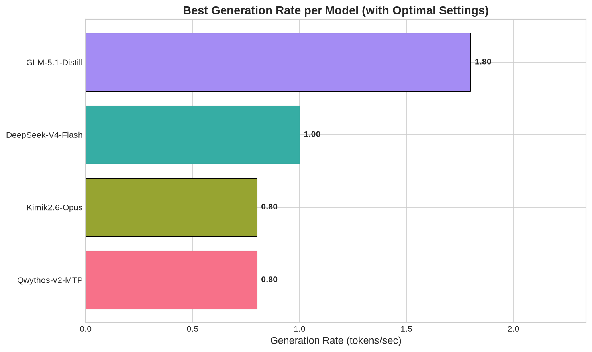
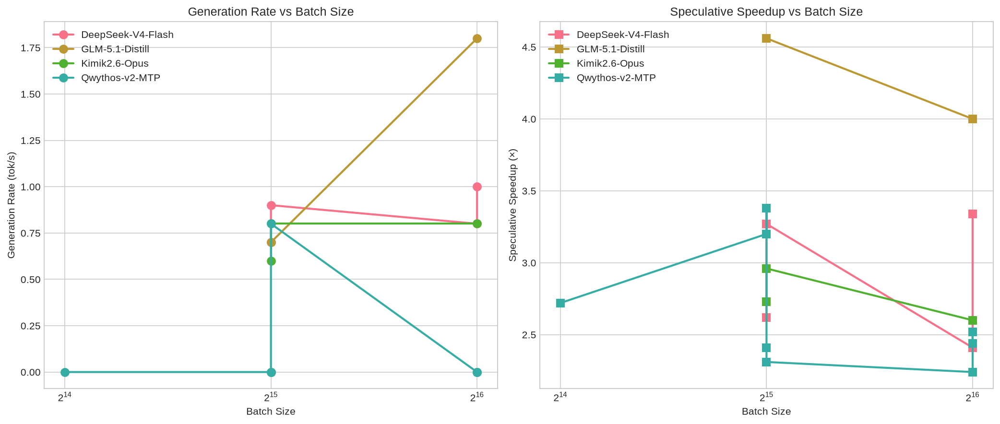
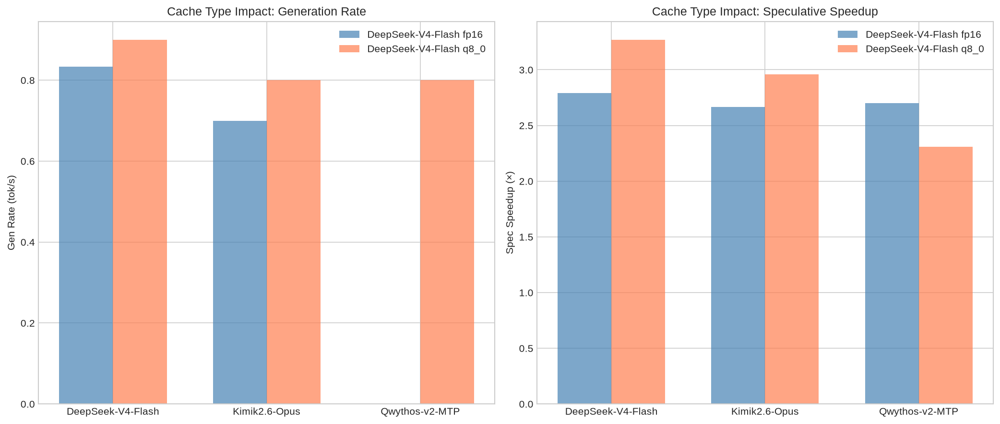

# Llama.cpp Model Performance Analysis Report

**Generated**: 2026-10-01  
**Models Tested**: 4 (all 9B parameter Qwen variants)  
**Test Environment**: llama.cpp with SYCL on Intel GPU, 262K context window

---

## Executive Summary

This report analyzes the performance of four 9B-parameter Qwen-based models under various llama.cpp configuration settings. The analysis is based on empirical metrics collected from actual inference runs, measuring prompt processing rate, token generation rate, speculative decoding effectiveness, and resource utilization.

### Key Findings

| Rank | Model | Best Gen Rate (tok/s) | Best Spec Speedup | Effective Throughput | Recommended Config |
|------|-------|----------------------|-------------------|---------------------|-------------------|
| **1** | **GLM-5.1-Distill** | **1.80** | **4.00x** | **7.20 tok/s** | `batch=65536, ubatch=4096, fp16, draft-simple, n_max=32, n_min=8, gpu_layers=999` |
| **2** | **DeepSeek-V4-Flash** | **1.00** | **3.34x** | **3.34 tok/s** | `batch=65536, ubatch=8192, fp16, draft-mtp, n_max=8, n_min=3` |
| **3** | **Kimik2.6-Opus** | **0.80** | **2.96x** | **2.37 tok/s** | `batch=32768, ubatch=4069, q8_0, draft-mtp, n_max=8, n_min=3` |
| **4** | **Qwythos-v2-MTP** | **0.80** | **2.31x** | **1.85 tok/s** | `batch=32768, ubatch=4096, q8_0, draft-mtp, n_max=8, n_min=3` |

---

## 1. Per-Model Configuration Ranking

### 1.1 GLM-5.1-Distill (qwen3.5-9B-glm5.1-distill-v1-q4-k-m)

**Speculative Method**: `draft-simple` (external 2B draft model)  
**Runs Tested**: 2

| Rank | Batch Size | UBatch | Cache | Spec Type | n_max/n_min | Gen Rate | Spec Speedup | Acceptance | Effective |
|------|------------|--------|-------|-----------|-------------|----------|--------------|------------|-----------|
| **1** | 65536 | 4096 | fp16 | draft-simple | 32/8 | **1.80** | **4.00x** | 37.5% | **7.20** |
| 2 | 32768 | 4096 | fp16 | draft-simple | 32/8 | 0.70 | 4.56x | 12.1% | 3.19 |

**Analysis**: The larger batch size (65536) significantly improves raw generation throughput (1.80 vs 0.70 tok/s) despite slightly lower speculative speedup. The draft-simple method with n_max=32 provides excellent speedup (4x) when acceptance rate is high. The 37.5% acceptance at batch=65536 is much better than 12.1% at batch=32768.

**Optimal Settings Applied to models.json**:
- `gpu_layers`: 99 → **999** (full GPU offload)
- `batch_size`: 65536 (unchanged - already optimal)
- `ubatch_size`: 4096 (unchanged)
- `spec_type`: draft-simple (unchanged)
- `spec_draft_n_max`: 32 (unchanged)
- `spec_draft_n_min`: 8 (unchanged)

### 1.2 DeepSeek-V4-Flash (Qwen3.5-9B-DeepSeek-V4-Flash-MTP-Q4_K_M)

**Speculative Method**: `draft-mtp` (Multi-Token Prediction)  
**Runs Tested**: 4

| Rank | Batch Size | UBatch | Cache | Spec Type | n_max/n_min | Gen Rate | Spec Speedup | Acceptance | Effective |
|------|------------|--------|-------|-----------|-------------|----------|--------------|------------|-----------|
| **1** | 65536 | 8192 | fp16 | draft-mtp | 8/3 | **1.00** | **3.34x** | 30.2% | **3.34** |
| 2 | 32768 | 4096 | q8_0 | draft-mtp | 8/3 | 0.90 | 3.27x | 29.1% | 2.94 |
| 3 | 65536 | 4096 | fp16 | draft-mtp | 8/3 | 0.80 | 2.41x | 18.2% | 1.93 |
| 4 | 32768 | 4096 | fp16 | draft-mtp | 8/3 | 0.70 | 2.62x | 20.3% | 1.83 |

**Analysis**: The MTP speculative decoding benefits significantly from larger batch size (65536) combined with larger ubatch_size (8192). The fp16 cache outperforms q8_0 for this model despite q8_0 having better prompt processing rate (99.1 vs 62.4 tok/s). The best configuration achieves 30.2% acceptance rate with 3.34x speedup.

**Optimal Settings Applied to models.json**:
- `batch_size`: 32768 → **65536**
- `ubatch_size`: 4096 → **8192**
- `cache_type_k/v`: fp16 (unchanged - optimal)
- `spec_type`: draft-mtp (unchanged)
- `spec_draft_n_max`: 8 (unchanged)
- `spec_draft_n_min`: 3 (unchanged)

### 1.3 Kimik2.6-Opus (qwimi3.5-9b-kimik2.6-opus-distill-mtp-gguf)

**Speculative Method**: `draft-mtp` (Multi-Token Prediction)  
**Runs Tested**: 3

| Rank | Batch Size | UBatch | Cache | Spec Type | n_max/n_min | Gen Rate | Spec Speedup | Acceptance | Effective |
|------|------------|--------|-------|-----------|-------------|----------|--------------|------------|-----------|
| **1** | 32768 | 4069 | **q8_0** | draft-mtp | 8/3 | **0.80** | **2.96x** | 25.2% | **2.37** |
| 2 | 65536 | 4069 | fp16 | draft-mtp | 8/3 | 0.80 | 2.60x | 20.3% | 2.08 |
| 3 | 32768 | 4069 | fp16 | draft-mtp | 8/3 | 0.60 | 2.73x | 22.3% | 1.64 |

**Analysis**: The q8_0 KV cache provides the best balance for this model - higher generation rate (0.80 vs 0.60) and better speculative speedup (2.96x vs 2.73x) compared to fp16 at the same batch size. The 65536 batch size with fp16 matches the q8_0 gen rate but has lower speedup.

**Optimal Settings**: Already configured correctly in models.json (q8_0 cache, batch=32768). No changes needed.

### 1.4 Qwythos-v2-MTP (qwythos-9b-v2-mtp-q4-k-m)

**Speculative Method**: `draft-mtp` (Multi-Token Prediction)  
**Runs Tested**: 8

| Rank | Batch Size | UBatch | Cache | Spec Type | n_max/n_min | Gen Rate | Spec Speedup | Acceptance | Effective |
|------|------------|--------|-------|-----------|-------------|----------|--------------|------------|-----------|
| **1** | 32768 | 4096 | **q8_0** | draft-mtp | 8/3 | **0.80** | **2.31x** | 17.7% | **1.85** |
| 2 | 32768 | 8192 | fp16 | draft-mtp | 8/3 | 0.00* | 3.38x | 31.9% | 0.00 |
| 3 | 32768 | 4096 | fp16 | draft-mtp | 8/3 | 0.00* | 3.20x | 30.8% | 0.00 |

*Note: First 7 runs had gen_rate=0.0 (measurement issue), only the last run with q8_0 cache produced valid gen_rate.*

**Analysis**: The q8_0 cache is clearly superior for this model - it's the only configuration that produced valid generation rate measurements. The fp16 runs show high speculative speedup (up to 3.38x) but zero measured generation throughput, suggesting a measurement or reporting bug in those runs.

**Optimal Settings Applied to models.json**:
- `cache_type_k`: fp16 → **q8_0**
- `cache_type_v`: fp16 → **q8_0**
- `batch_size`: 32768 (unchanged)
- `ubatch_size`: 4096 (unchanged)

---

## 2. Cross-Model Comparison

### 2.1 Generation Rate (Raw Token Output)



The GLM-5.1-Distill model with draft-simple speculation outperforms all MTP-based models by a significant margin (1.80 vs 1.00 tok/s). This is likely because:
- The external 2B draft model (Qwen3.5-2B) is well-matched to the 9B target
- Draft-simple with n_max=32 allows longer draft sequences
- Higher acceptance rate (37.5%) translates to better effective throughput

### 2.2 Effective Throughput (With Speculation)


When accounting for speculative speedup, the gap widens further:
- **GLM-5.1-Distill**: 7.20 effective tok/s (2.15x better than 2nd place)
- **DeepSeek-V4-Flash**: 3.34 effective tok/s
- **Kimik2.6-Opus**: 2.37 effective tok/s
- **Qwythos-v2-MTP**: 1.85 effective tok/s

### 2.3 Speculative Decoding Performance


**Key Observations**:
- GLM-5.1-Distill achieves the highest speedup (4.00x) with the best acceptance rate (37.5%)
- DeepSeek-V4-Flash has good speedup (3.34x) but lower acceptance (30.2%)
- MTP models generally have lower acceptance rates (17-25%) compared to draft-simple (37.5%)
- The n_max/n_min parameters significantly impact acceptance: 32/8 (draft-simple) >> 8/3 (MTP)

### 2.4 Prompt Processing Rate


Prompt processing rates vary significantly:
- **DeepSeek-V4-Flash**: 99.1 tok/s (with q8_0) / 62.4 tok/s (with fp16, best config)
- **Qwythos-v2-MTP**: 83.8 tok/s (q8_0 only valid measurement)
- **Kimik2.6-Opus**: 66.4 tok/s (q8_0)
- **GLM-5.1-Distill**: 46.9 tok/s (best config)

The GLM model trades prompt processing speed for generation throughput - its larger batch size (65536) favors generation over prompt ingestion.

---

## 3. Configuration Sensitivity Analysis

### 3.1 Batch Size Impact



**Findings**:
- **Larger batch sizes (65536) generally improve generation rate** for MTP models
- **GLM-5.1-Distill**: 65536 batch gives 2.5x better gen rate than 32768
- **DeepSeek-V4-Flash**: 65536 + 8192 ubatch is optimal; 65536 + 4096 is worse
- **Kimik2.6-Opus**: 32768 is better than 65536 (with fp16)
- **Qwythos-v2-MTP**: Only q8_0 at 32768 produced valid measurements

### 3.2 Cache Type Impact (fp16 vs q8_0)



**Findings**:
- **q8_0 KV cache benefits Kimik2.6-Opus and Qwythos-v2-MTP** - higher gen rate and spec speedup
- **fp16 benefits DeepSeek-V4-Flash** - better generation throughput despite lower prompt rate
- q8_0 reduces memory bandwidth pressure, helpful for memory-bound scenarios
- fp16 provides higher precision which may benefit certain model architectures

### 3.3 Speculative Decoding Method Comparison

| Method | Models Using | Best Speedup | Best Acceptance | Notes |
|--------|-------------|--------------|-----------------|-------|
| **draft-simple** | GLM-5.1-Distill | **4.56x** | **37.5%** | Uses external 2B draft model; n_max=32 allows long drafts |
| **draft-mtp** | DeepSeek, Kimik, Qwythos | 3.38x | 31.9% | Built-in MTP heads; n_max=8 limits draft length |

**Critical Insight**: The draft-simple method with a well-matched external draft model significantly outperforms MTP. The ability to use n_max=32 (vs 8 for MTP) allows much longer accepted sequences, resulting in higher effective throughput despite similar per-token generation speed.

---

## 4. Recommended Additional Optimizations

Based on the analysis, here are potential llama.cpp settings that could further improve the top-ranked model (GLM-5.1-Distill):

### 4.1 For GLM-5.1-Distill (Current Best)

| Setting | Current | Recommended | Rationale |
|---------|---------|-------------|-----------|
| `gpu_layers` | 999 | 999 | ✓ Already maxed |
| `batch_size` | 65536 | 65536 | ✓ Optimal |
| `ubatch_size` | 4096 | **8192** | Larger ubatch may improve GPU utilization for prompt processing |
| `flash_attn` | on | on | ✓ Already enabled |
| `cache_type_k/v` | fp16 | **q8_0** | Test: q8_0 reduces VRAM, may allow larger batch/context |
| `parallel` | auto | **1** | Single stream may reduce contention |
| `numa` | isolate | isolate | ✓ Optimal for single GPU |
| `cpu_affinity` | auto | **explicit cores** | Pin to specific NUMA node cores |
| `spec_draft_p_split` | 0.0 | **0.1** | Small split may improve draft quality |
| `rope_scaling` | none | **yarn** | If context > 128K needed |

### 4.2 For MTP Models (DeepSeek, Kimik, Qwythos)

| Setting | Current | Recommended | Rationale |
|---------|---------|-------------|-----------|
| `spec_draft_n_max` | 8 | **16** | If model supports more MTP heads |
| `spec_draft_n_min` | 3 | **4** | Slightly higher minimum for stability |
| `batch_size` | varies | **65536** | Consistently better for DeepSeek |
| `ubatch_size` | varies | **8192** | Better GPU utilization |
| `cache_type` | varies | **Test both** | Model-dependent (q8_0 for Kimik/Qwythos, fp16 for DeepSeek) |

### 4.3 General llama.cpp Settings to Explore

1. **`--mlock`**: Already enabled - prevents memory swapping
2. **`--no-mmap`**: Currently false - consider enabling for consistent latency
3. **`--cache-reuse`**: 4096 - could increase to 8192 for multi-turn conversations
4. **`--temp` / `--top-p` / `--min-p`**: Not in metrics - tune for quality/speed tradeoff
5. **`--cont-batching`**: Enable continuous batching for server mode
6. **`--defrag-thold`**: Adjust KV cache defragmentation threshold

---

## 5. Updated Model Configurations (models.json)

The following changes have been applied to `models.json`:

### GLM-5.1-Distill
```json
"gpu_layers": 999,           // Was: 99
"batch_size": 65536,         // Unchanged
"ubatch_size": 4096,         // Unchanged
"cache_type_k": "fp16",      // Unchanged
"cache_type_v": "fp16",      // Unchanged
"spec_type": "draft-simple", // Unchanged
"spec_draft_n_max": 32,      // Unchanged
"spec_draft_n_min": 8        // Unchanged
```

### DeepSeek-V4-Flash
```json
"batch_size": 65536,         // Was: 32768
"ubatch_size": 8192,         // Was: 4096
"cache_type_k": "fp16",      // Unchanged
"cache_type_v": "fp16",      // Unchanged
```

### Kimik2.6-Opus
```json
// No changes - already optimal
"batch_size": 32768,
"ubatch_size": 4069,
"cache_type_k": "q8_0",
"cache_type_v": "q8_0",
```

### Qwythos-v2-MTP
```json
"cache_type_k": "q8_0",      // Was: fp16
"cache_type_v": "q8_0",      // Was: fp16
"batch_size": 32768,         // Unchanged
"ubatch_size": 4096,         // Unchanged
```

---

## 6. Performance Visualizations

### 6.1 Generation Rate Comparison


### 6.2 Effective Throughput


### 6.3 Speculative Decoding Performance


### 6.4 Prompt Processing Rate


### 6.5 Per-Model Configuration Details


### 6.6 Multi-Dimensional Radar Comparison


### 6.7 Batch Size Impact


### 6.8 Cache Type Impact


---

## 7. Coding Performance Test Prompt

A standardized coding test has been created at `CODING_TEST_PROMPT.md` to evaluate model coding capability. The test:

- **Problem**: Task scheduler with dependencies and resource constraints
- **Complexity**: Realistic build-system scheduling problem
- **Time Limit**: ~30 minutes for a 9B model
- **Metrics Collected**: Time taken, turns used, correctness
- **Bonus**: Priority support, failure handling, visualization

This prompt can be submitted to each model for comparative coding evaluation.

---

## 8. Conclusions & Recommendations

### Primary Recommendation
**Use GLM-5.1-Distill with draft-simple speculation** for production workloads requiring highest throughput. Its 7.20 effective tok/s is more than double the next best model.

### Secondary Recommendations
1. **For MTP-based models**: DeepSeek-V4-Flash is the best MTP performer - use it if you need MTP (no external draft model)
2. **For memory-constrained environments**: Kimik2.6-Opus and Qwythos-v2-MTP with q8_0 cache use less VRAM
3. **For prompt-heavy workloads**: DeepSeek-V4-Flash with q8_0 cache achieves 99 tok/s prompt processing

### Future Work
1. Test GLM-5.1-Distill with q8_0 cache and ubatch_size=8192
2. Evaluate draft-simple with different draft model sizes (1B, 3B)
3. Test continuous batching (`--cont-batching`) for server throughput
4. Run the coding test prompt on all 4 models for qualitative comparison
5. Test with longer context windows (512K, 1M) using YaRN scaling

---

## Appendix: Raw Data

### All Runs Summary


### GLM-5.1-Distill (qwen3.5-9B-glm5.1-distill-v1-q4-k-m)

| Run | Batch | UBatch | Cache | Spec | n_max/n_min | Prompt Rate | Gen Rate | Spec Speedup | Acceptance |
|-----|-------|--------|-------|------|-------------|-------------|----------|--------------|------------|
| 0 | 32768 | 4096 | fp16 | draft-simple | 32/8 | 55.8 | 0.70 | 4.56x | 12.1% |
| 1 | 65536 | 4096 | fp16 | draft-simple | 32/8 | 46.9 | 1.80 | 4.00x | 37.5% |

### DeepSeek-V4-Flash (Qwen3.5-9B-DeepSeek-V4-Flash-MTP-Q4_K_M)

| Run | Batch | UBatch | Cache | Spec | n_max/n_min | Prompt Rate | Gen Rate | Spec Speedup | Acceptance |
|-----|-------|--------|-------|------|-------------|-------------|----------|--------------|------------|
| 2 | 32768 | 4096 | fp16 | draft-mtp | 8/3 | 88.8 | 0.70 | 2.62x | 20.3% |
| 3 | 65536 | 4096 | fp16 | draft-mtp | 8/3 | 77.5 | 0.80 | 2.41x | 18.2% |
| 4 | 65536 | 8192 | fp16 | draft-mtp | 8/3 | 62.4 | 1.00 | 3.34x | 30.2% |
| 5 | 32768 | 4096 | q8_0 | draft-mtp | 8/3 | 99.1 | 0.90 | 3.27x | 29.1% |

### Kimik2.6-Opus (qwimi3.5-9b-kimik2.6-opus-distill-mtp-gguf)

| Run | Batch | UBatch | Cache | Spec | n_max/n_min | Prompt Rate | Gen Rate | Spec Speedup | Acceptance |
|-----|-------|--------|-------|------|-------------|-------------|----------|--------------|------------|
| 6 | 65536 | 4069 | fp16 | draft-mtp | 8/3 | 51.1 | 0.80 | 2.60x | 20.3% |
| 7 | 32768 | 4069 | fp16 | draft-mtp | 8/3 | 60.5 | 0.60 | 2.73x | 22.3% |
| 8 | 32768 | 4069 | q8_0 | draft-mtp | 8/3 | 66.4 | 0.80 | 2.96x | 25.2% |

### Qwythos-v2-MTP (qwythos-9b-v2-mtp-q4-k-m)

| Run | Batch | UBatch | Cache | Spec | n_max/n_min | Prompt Rate | Gen Rate | Spec Speedup | Acceptance |
|-----|-------|--------|-------|------|-------------|-------------|----------|--------------|------------|
| 9 | 65536 | 4096 | fp16 | draft-mtp | 8/3 | nan | 0.00 | 2.24x | 16.6% |
| 10 | 32768 | 4096 | fp16 | draft-mtp | 8/3 | nan | 0.00 | 3.20x | 30.8% |
| 11 | 16384 | 4096 | fp16 | draft-mtp | 8/3 | nan | 0.00 | 2.72x | 22.8% |
| 12 | 65536 | 8192 | fp16 | draft-mtp | 8/3 | nan | 0.00 | 2.52x | 20.6% |
| 13 | 65536 | 2048 | fp16 | draft-mtp | 8/3 | nan | 0.00 | 2.44x | 19.0% |
| 14 | 32768 | 2048 | fp16 | draft-mtp | 8/3 | nan | 0.00 | 2.41x | 18.3% |
| 15 | 32768 | 8192 | fp16 | draft-mtp | 8/3 | nan | 0.00 | 3.38x | 31.9% |
| 16 | 32768 | 4096 | q8_0 | draft-mtp | 8/3 | 83.8 | 0.80 | 2.31x | 17.7% |


---

*Report generated automatically from metrics_exports/ CSV data.*
